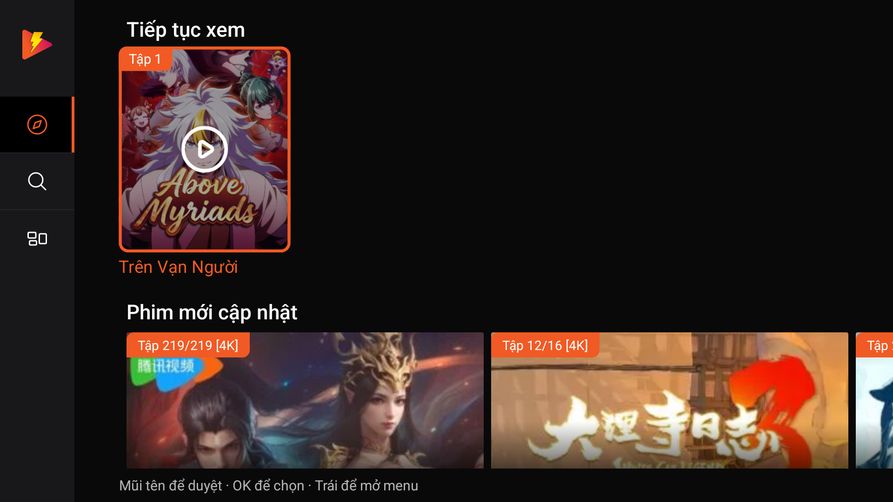
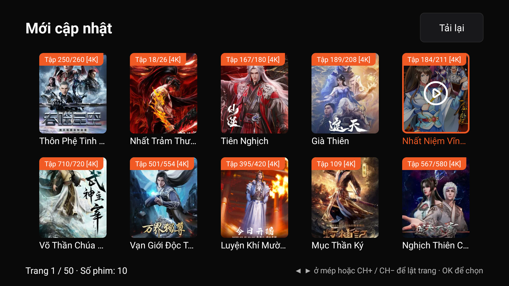

<div align="center">


# AniBolt

**A fast, remote-first Android TV app for watching Chinese animation (donghua) in Vietnamese.**

Browse, search and play from the couch with nothing but a TV remote: no mouse, no pop-ups, no web page clutter.

[](https://github.com/latiosthinh/anibolt/releases/latest)


</div>

---

<p align="center">
  
  
</p>

## ✨ Features

| | |
| --- | --- |
| 🏠 **Home** | *Tiếp tục xem* (continue watching), a *Phim mới cập nhật* hero row ending in **Xem tất cả**, a curated shelf and genre tiles |
| 🧭 **Left menu** | Khám phá · Mới cập nhật · Tìm kiếm · Thể loại. Icons only, widening with labels while it has focus |
| 📄 **Paged listings** | A whole page of 10 posters on one screen with no scrolling. Turn pages with **CH+ / CH−** or by pressing past the edge of the grid |
| 🔎 **Live search** | Suggestions with thumbnails as you type, with the typed part highlighted (diacritic-aware), and full paged results on Enter |
| 🎬 **Details** | Poster, synopsis, *Xem tiếp* / latest episode, and long series split into ranges of 10 episodes (1–10, 11–20 …) |
| ▶️ **Player** | Autoplays the site's own player full screen behind native round icon controls: play/pause, ±10 s, start over, next episode, reload |
| ⏩ **Seek slider** | Hold ◀ ▶ to scrub (10 s → 30 s → 60 s steps), then OK or a short pause jumps there |
| 💾 **Watch history** | Remembers the last episode of each series on the device and marks it in the episode grid |
| ⚡ **Light on the TV** | ~2 MB R8 release build, an ad/analytics blocklist inside the player, memory released when backgrounded, and recovery if the WebView renderer crashes |

## 🎮 Remote controls

| Where | Key | Action |
| --- | --- | --- |
| Everywhere | ◀ ▶ ▲ ▼ / OK | Move / choose |
| Everywhere | Back | Move focus to the menu first, then leave |
| Rows and grids | ◀ on the first card | Open the left menu |
| Listings | CH+ / CH− (or Page Up/Down) | Next / previous page |
| Listings | ▶ past the last card / ◀ past the first | Next / previous page, staying on the same row |
| Player, controls hidden | OK · ◀ ▶ · ▲ ▼ | Play/pause · seek ±10 s · show controls |
| Player, on the slider | ◀ ▶ (hold to speed up) · OK · ▼ | Scrub · jump there · go to the buttons |
| Player, on the buttons | ▼ | Hide the controls |
| Player | ⏯ ⏪ ⏩ ⏭ media keys | Toggle · rewind · forward · next episode (⏮ starts over) |

## 🚀 Install

### Download

Grab **`AniBolt-v1.0.0.apk`** from the [latest release](https://github.com/latiosthinh/anibolt/releases/latest) and sideload it: `adb install -r AniBolt-v1.0.0.apk`, or open it from a USB stick with a file manager on the TV.

### Build and install yourself

You need [adb](https://developer.android.com/tools/adb) and a TV with **Developer options → USB/Network debugging** turned on.

```bash
# Find and connect to the TV on your network
adb mdns services
adb connect 192.168.1.xxx:5555

# Build the optimized release APK (signed with the debug key, so it installs over a debug build)
./gradlew assembleRelease

# Install
adb install -r app/build/outputs/apk/release/app-release.apk
```

AniBolt appears on the TV home screen with its own launcher banner.

## 🛠 Build from source

| Requirement | Version |
| --- | --- |
| JDK | 17 |
| Android SDK | compileSdk 34 (set `sdk.dir` in `local.properties`) |
| Gradle | wrapper included |

```bash
./gradlew assembleDebug lintDebug   # debug build + lint (kept at 0 errors)
./gradlew assembleRelease           # R8-minified, resource-shrunk release
```

## 🧱 How it works

AniBolt scrapes the provider's catalog pages natively and keeps the provider's **own video player** inside a WebView, dressed up as a native TV player.

```
┌──────────────── Native (Kotlin + Leanback) ───────────────┐        ┌──── WebView ────┐
│ MainActivity     home rows + left menu (NavRail)          │        │ provider player │
│ SearchActivity   search · genre · "Mới cập nhật" listings │ ─────► │  + injected JS  │
│ DetailsActivity  synopsis, ranges, episode grid           │        │ tv-player.js    │
│ PlayerActivity   native controls ◄── postMessage ─────────┼────────┤ player-only.js  │
│ HhpandaScraper   OkHttp + Jsoup → Anime / Episode models  │        │ no-native-...js │
└───────────────────────────────────────────────────────────┘        └─────────────────┘
```

- **Scraping**: `scraper/HhpandaScraper.kt` reads listings, details, live search and the page count from the site's WordPress pagination.
- **Player bridge**: `assets/tv-player.js` runs in every frame. It hides the embed's controls, autoplays only in the real player frame, and answers fixed `postMessage` commands (`toggle`, `seek:<s>`, `restart`…) with progress reports.
- **Hardening**: `PlayerRequestFilter` returns an empty 204 for ad and analytics hosts. Timers pause in `onStop`. A killed renderer recreates the screen instead of crashing the app.

```
app/src/main/
├── java/com/animetv/
│   ├── MainActivity.kt · SearchActivity.kt · DetailsActivity.kt · CategoryActivity.kt · PlayerActivity.kt
│   ├── AniBoltApp.kt            memory trimming when backgrounded
│   ├── PlayerRequestFilter.kt   ad / analytics blocklist
│   ├── WatchHistory.kt          last episode per series (SharedPreferences)
│   ├── scraper/  model/  ui/    (NavRail, LoadingView, card views)
├── assets/                      scripts injected into the player WebView
└── res/                         layouts, vector icons, Vietnamese strings
```

## ✅ Testing

```bash
# Unit tests for the injected player scripts (node:vm, fake DOM and frames)
node scripts/test-player-controls.cjs

# End-to-end D-pad suite over adb + uiautomator (Windows PowerShell)
# ⚠ Runs `pm clear` first, which wipes the app's watch history on that device
powershell -File scripts/test-tv-remote.ps1 -Serial 192.168.1.xxx:5555
```

Every UI change is logged as *finding → impact → fix* in [`docs/UI-UX-AUDIT.md`](docs/UI-UX-AUDIT.md).

## ⚠️ Disclaimer

AniBolt is an unofficial, personal-use client. It hosts no video and is not affiliated with the website it reads. All titles, artwork and streams belong to their respective owners. If you are a rights holder and have concerns, please open an issue.

<div align="center">

Made for the couch with ❤️ and a TV remote.

</div>
